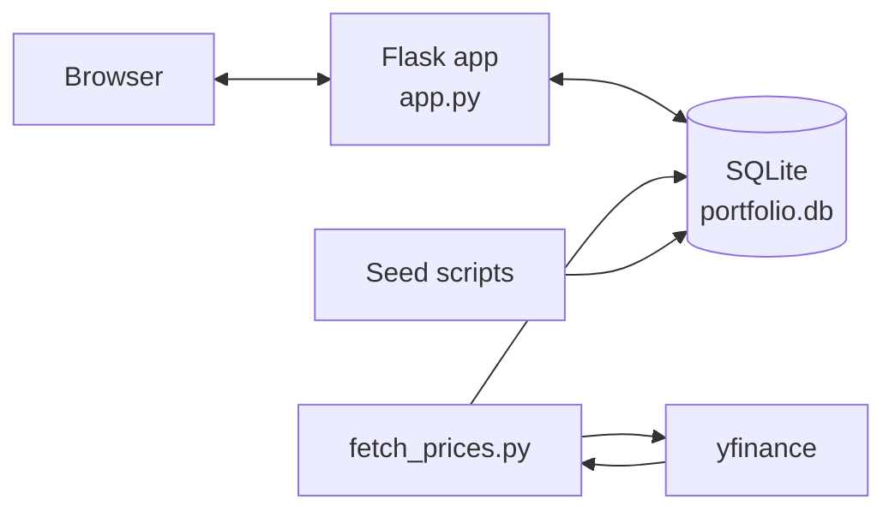

<div align="center">

# JSE Portfolio Tracker

### A small, hands-on tracker for Johannesburg Stock Exchange shares

Follow a curated list of JSE companies, look up their latest available prices, and keep a record of portfolio transactions.


[Explore the code](https://github.com/unathi3/jse-portfolio-tracker) · [Run it locally](#-get-started)

</div>

---

## On this page

- [Project overview](#-project-overview)
- [What you can do](#-what-you-can-do)
- [Get started](#-get-started)
- [Try the app](#-try-the-app)
- [How it fits together](#-how-it-fits-together)
- [Notes and limitations](#-notes-and-limitations)

## 📌 Project overview

JSE Portfolio Tracker is a lightweight Flask application built around a practical question: how can I keep a simple, locally stored view of selected South African shares and the transactions I make?

The app uses **Python and Flask** for its web routes, **SQLite** for local persistence, and **yfinance** to retrieve market-price data. The starter share list includes companies such as Naspers, Prosus, FirstRand, and Standard Bank.

## ✨ What you can do

| Capability | What it does |
| --- | --- |
| Browse supported shares | View company names, sectors, and the most recently stored price. |
| Record transactions | Log a buy or sell with a share, quantity, price per share, and date. |
| Review transaction history | See saved transactions ordered by date. |
| Store data locally | Keep share, price-history, portfolio, and transaction records in SQLite. |
| Fetch JSE prices | Retrieve prices for the configured shares using yfinance. |

### A quick tour

1. **Initialize** the local database and starter data.
2. **Fetch prices** for the configured JSE tickers.
3. **Open the home page** to browse the supported shares and their latest stored prices.
4. **Log transactions** and review them in the transaction history.

## 🚀 Get started

### Requirements

- Python 3
- An internet connection for fetching prices from yfinance

### 1. Create an environment and install dependencies

```bash
python -m venv .venv
```

Activate it:

```bash
# macOS / Linux
source .venv/bin/activate

# Windows PowerShell
.venv\Scripts\Activate.ps1
```

Install the packages used by the app and price-fetching script:

```bash
python -m pip install Flask yfinance
```

### 2. Create and seed the database

Run these commands from the project directory:

```bash
python database.py
python seed_sectors.py
python seed_portfolio.py
```

### 3. Fetch share prices

```bash
python fetch_prices.py
```

This contacts yfinance and stores the returned prices in the local database. Price availability depends on the external data provider.

### 4. Start the app

```bash
python app.py
```

Open [http://127.0.0.1:5000](http://127.0.0.1:5000) in your browser.

<details>
<summary><strong>Setup tips</strong></summary>

- Run the setup commands from the repository root so SQLite creates `portfolio.db` in the expected location.
- The seed scripts add the starter share list and a portfolio record. Run them once against a fresh database.
- The app uses JSE ticker symbols ending in `.JO` (for example, `NPN.JO`) in its seeded data.
- If fetching prices fails, check your internet connection and try again later; price retrieval relies on yfinance.

</details>

## 🧭 Try the app

- On the home page, browse the configured shares, sectors, and latest saved prices.
- Choose **Log a new transaction** to record a buy or sell.
- Open **Transaction History** to review saved entries.
- To refresh displayed prices, run `python fetch_prices.py` again from the project directory.

Prices are shown in South African rand (R). The fetch script converts yfinance's JSE price values from cents to rand before saving them.

## 🏗️ How it fits together



| File | Responsibility |
| --- | --- |
| [`app.py`](./app.py) | Flask routes for the share list and transaction pages. |
| [`database.py`](./database.py) | SQLite connection and table initialization. |
| [`fetch_prices.py`](./fetch_prices.py) | Fetches prices for configured tickers and saves price history. |
| [`seed_sectors.py`](./seed_sectors.py) | Adds the starter companies and sector labels. |
| [`seed_portfolio.py`](./seed_portfolio.py) | Creates the initial portfolio record used by the app. |
| [`templates/`](./templates/) | Jinja templates for the web pages. |

## ℹ️ Notes and limitations

- This is a learning and portfolio project, not investment advice or a trading platform.
- Market prices come from an external data provider and may be delayed, incomplete, or unavailable.
- The app currently focuses on share listings and transaction record-keeping. It does **not** calculate portfolio performance, holdings valuation, or realized/unrealized returns.
- Data is stored locally in `portfolio.db`; this repository does not include deployment instructions or a production hosting setup.

---

<div align="center">

Built as a practical exploration of Python web development, relational data, and market-data integration.

</div>
